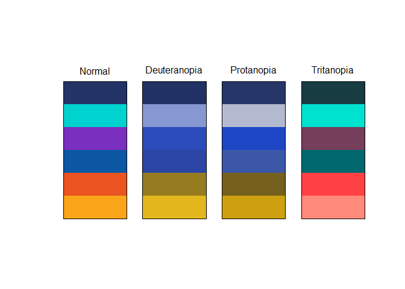

# **linuxcolors: color palettes from the identity colors of the most popular Linux distros** <a href='https://github.com/ikashnitsky/linuxcolors'></a>


## Installation

``` r
# Install from GitHub
pak::pak("ikashnitsky/linuxcolors")
```

## Palettes

``` r
library(linuxcolors)
library(tidyverse)
```

    ── Attaching core tidyverse packages ──────────────────────── tidyverse 2.0.0 ──
    ✔ dplyr     1.2.0     ✔ readr     2.2.0
    ✔ forcats   1.0.1     ✔ stringr   1.6.0
    ✔ ggplot2   4.0.2     ✔ tibble    3.3.1
    ✔ lubridate 1.9.5     ✔ tidyr     1.3.2
    ✔ purrr     1.2.1     
    ── Conflicts ────────────────────────────────────────── tidyverse_conflicts() ──
    ✖ dplyr::filter() masks stats::filter()
    ✖ dplyr::lag()    masks stats::lag()
    ℹ Use the conflicted package (<http://conflicted.r-lib.org/>) to force all conflicts to become errors

``` r
library(prismatic)
library(colorspace)
```


    Attaching package: 'colorspace'

    The following object is masked from 'package:prismatic':

        contrast_ratio

``` r
# main
linuxcolors_palettes$main |>color() |> plot()
```


``` r
# additional
linuxcolors_palettes$additional |> color() |> plot()
```


``` r
# larger
linuxcolors_palettes$larger |> color() |> plot()
```


``` r
# max_paired
linuxcolors_palettes$max_paired |> color() |> plot()
```


``` r
# diverging
linuxcolors_palettes$diverging |> color() |> plot()
```


``` r
# sequential_green
linuxcolors_palettes$sequential_green |> color() |> plot()
```


``` r
# colorblind_strict
linuxcolors_palettes$colorblind_strict |> color() |> plot()
```


``` r
linuxcolors_palettes$colorblind_strict |> color() |> check_color_blindness()
```



``` r
# neon
linuxcolors_palettes$neon |> color() |> plot()
```


## Usage

``` r
library(tidyverse)
library(linuxcolors)


# Discrete color scale example
swiss |>
  ggplot(
    aes(x = Agriculture, y = Fertility, color = Catholic > 50)
  ) +
  geom_point(size = 3) +
  stat_ellipse()+
  scale_color_linux("neon")


# Discrete fill scale example
swiss |> 
  mutate(Religion = ifelse(Catholic > 50, "Catholic", "Protestant")) |>
  ggplot(aes(x = Fertility, fill = Religion)) +
  geom_density(alpha = 0.7) +
  scale_fill_linux("main")

# Continuous color scale example
swiss |>
  ggplot(aes(x = Agriculture, y = Fertility, color = Education)) +
  geom_point(size = 3) +
  scale_color_linux("diverging", discrete = FALSE)
```

## License

This package is FOSS under MIT License. See the file LICENSE for
details.

## A note on AI helpers

This package was created with the assistance of AI tools, including
Claude Sonnet 4.6 via Perplexity, Gemini Pro 3.1 via Gemini and
Antigravity. `inst/init` contains the jumpstarter prompts used to
conceptualize the package. The main part of the coding was done using
Antigravity. `inst/antigravity` contain the i plementation plan and
walkthrough,`inst/antigravity/session.json` contains the session
history. The package logo was created using nanobanana 2 model in
Gemini.
